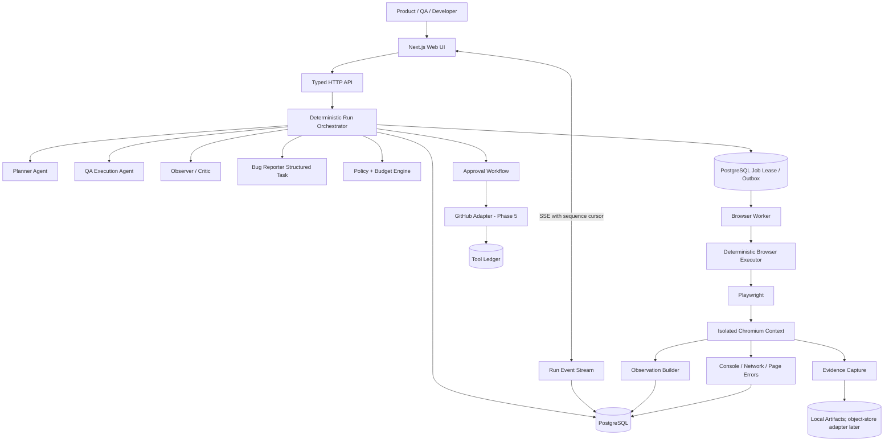
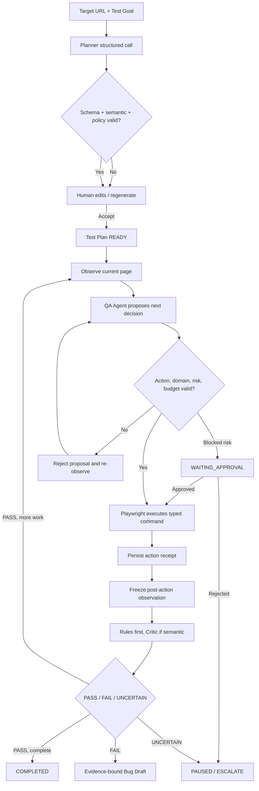
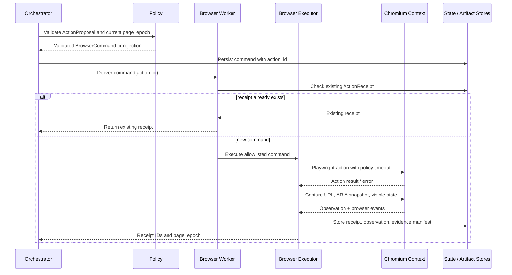
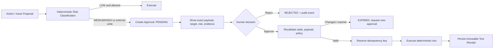
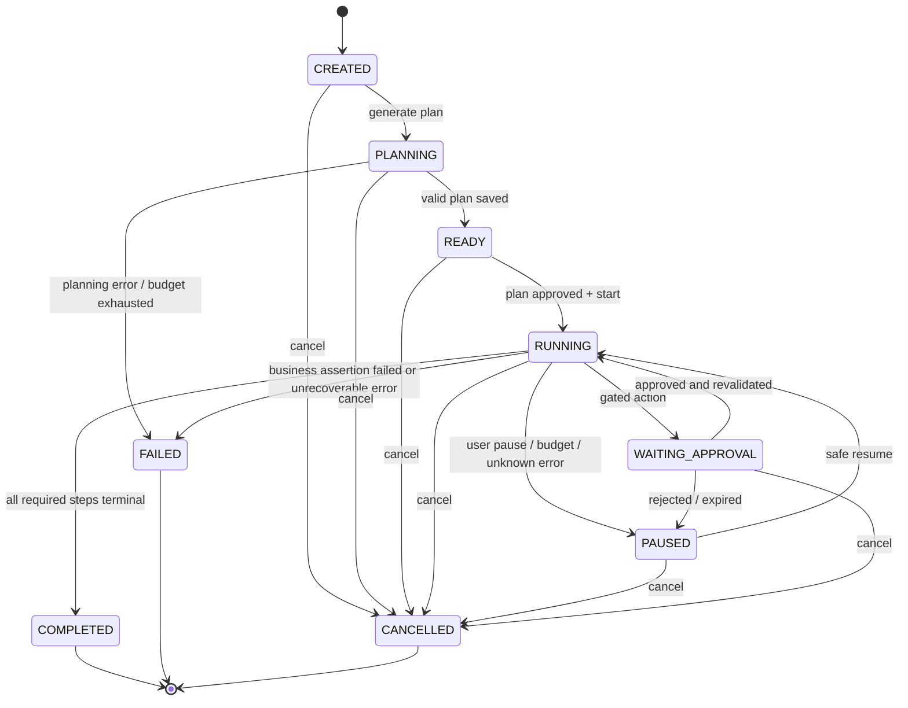

# Sentinel — System Architecture

> Phase 0 design. No runtime is implemented in this phase.

## 1. Architectural goals

- Real browser actions are executed only by Playwright.
- Every conclusion is traceable to a reviewed plan, action receipt, observation, and evidence.
- LLM output is untrusted structured data, never direct authority.
- Run state survives process failure and never silently becomes PASS.
- High-risk and external writes require human approval.
- The MVP remains a modular monolith plus a dedicated Browser Worker.

## 2. System architecture

### Deployment boundary

- `web/api`: user-facing control plane; never launches a browser inside an HTTP request.
- `worker`: long-running data-plane process allowed to launch Chromium.
- PostgreSQL: canonical Run/Step/Decision/Action/Observation/Finding state and job leases.
- artifact store: screenshot, trace, DOM extract, and reports. Binary data is not stored in PostgreSQL.
- LLM providers: accessed only through an adapter with schema validation, budgets, redaction, and call metadata.

## 3. Agent workflow

The model's private reasoning is not stored. Only typed input metadata, typed output, concise reason, confidence, token/cost data, and prompt/model version are retained.

## 4. Browser execution

### Browser invariants

- One active worker lease and one BrowserContext per Run.
- Element refs are valid only for the observation's `page_epoch`.
- The worker resolves refs to Playwright locators; the model never supplies arbitrary selectors in MVP.
- All navigations and redirects are revalidated against allowed domains and resolved IP policy.
- Console, pageerror, request, response, and requestfailed listeners are attached before navigation.
- A screenshot failure or telemetry failure becomes an evidence-health error, not a silent PASS.
- Downloads are denied by default. File upload, arbitrary JavaScript, and network mocking are unavailable to the QA Agent.

## 5. Approval flow

Approval is bound to a payload hash and state version. Editing the Issue Draft or destructive action parameters invalidates prior approval.

## 6. Run state machine

The product-facing state set follows the Master Specification. Internal substates are stored in step/action records rather than added to the public Run enum.

### Verdict vs Run status

- Step verdict: `PASS | FAIL | UNCERTAIN`.
- Run status describes lifecycle: `CREATED | PLANNING | READY | RUNNING | PAUSED | WAITING_APPROVAL | COMPLETED | FAILED | CANCELLED`.
- Run result is a separate field: `PASS | FAIL | UNCERTAIN | NOT_EVALUATED`.
- Required step FAIL gives Run result FAIL.
- Required step UNCERTAIN gives Run result UNCERTAIN; it must never be coerced to PASS.
- Infrastructure/agent failure uses lifecycle FAILED plus an error classification; it does not automatically create a product bug.

## 7. Controlled loop and budgets

The Orchestrator, not an Agent, enforces:

- `max_steps`;
- `max_retries_per_step`;
- `max_run_time_ms`;
- `max_llm_calls`;
- `max_tokens`;
- `max_estimated_cost`.

Budget checks run before every LLM call and browser command. Exceeding a soft limit pauses the Run; exceeding a hard safety limit terminates active work and saves a checkpoint. Models cannot raise budgets.

## 8. Retry classification

| Class | Example | Policy |
| --- | --- | --- |
| Transient | one navigation timeout, temporary connection reset | Limited retry with backoff if command is safe/idempotent |
| Automation error | stale ref, locator no longer resolves | Re-observe and request a new decision; does not consume business retry |
| Business assertion failure | renamed value reverts after refresh | No retry to hide failure; capture evidence and report FAIL |
| Unknown outcome | timeout after submitting destructive/create action | Do not replay; pause with UNKNOWN_OUTCOME |
| Browser crash | process exit | Restore from checkpoint only if safe-continue/replay classification permits |

## 9. Checkpoint and recovery

Checkpoint after plan approval, authentication, each completed plan step, before/after a gated action, and on pause/error.

Recovery modes:

- `SAFE_CONTINUE`: browser/storage state and last receipt prove the next action has not begun.
- `SAFE_REPLAY`: the last action is read-only/idempotent and its postcondition can be checked before replay.
- `UNSAFE_UNKNOWN`: an external/destructive/create command may have happened but no receipt exists. Pause for human review.

Storage state is an encrypted artifact reference, not a normal text field and never an LLM input.

## 10. Event and trace model

Each Run has a monotonic event sequence. Representative events:

`RUN_CREATED`, `PLAN_GENERATED`, `PLAN_APPROVED`, `STEP_STARTED`, `DECISION_RECORDED`, `ACTION_VALIDATED`, `ACTION_EXECUTED`, `OBSERVATION_CAPTURED`, `ASSERTION_RECORDED`, `EVIDENCE_CAPTURED`, `CHECKPOINT_SAVED`, `APPROVAL_REQUESTED`, `RUN_PAUSED`, `RUN_COMPLETED`.

SSE clients reconnect using the last seen sequence. Current state is stored relationally; events provide audit and live delivery, not the only state representation.

## 11. Module boundaries

Proposed future monorepo modules, not created in Phase 0:

- `apps/web`: UI and BFF.
- `apps/api`: typed HTTP control plane.
- `apps/worker`: browser and background job process.
- `apps/demo-target`: TaskForge with break modes.
- `packages/contracts`: schemas and generated API types.
- `packages/agent-core`: prompts, structured agent clients, budgets.
- `packages/browser-executor`: direct Playwright adapter.
- `packages/db`: Drizzle schema, migrations, repositories.
- `packages/llm`: provider interface, DeepSeek and Mock providers.
- `packages/evaluation`: case runner and metric computation.

## 12. Technology decisions

- TypeScript strict across apps/packages.
- pnpm workspace.
- Next.js UI; Fastify API; Node.js worker.
- direct Playwright library.
- PostgreSQL + Drizzle.
- local filesystem artifact adapter for MVP, S3-compatible adapter later.
- SSE for live trace.
- explicit TypeScript state machine; no LangGraph until a later ADR proves need.

## 13. Deferred decisions

- Exact supported Node/Next/Playwright versions are selected and pinned in Phase 1 after compatibility testing.
- Hosting topology and multi-tenant isolation.
- Object storage provider and retention duration.
- LLM model selection after baseline evaluation.
- Whether a dedicated workflow engine is justified by later scale and long human waits.

