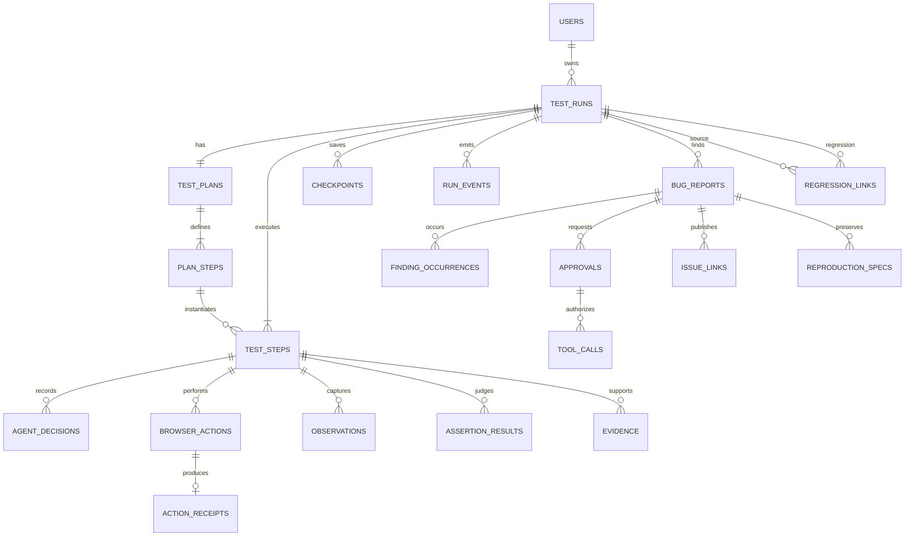

# Sentinel — Data Model Contract

> Phase 0 logical design. PostgreSQL + Drizzle is selected in ADR-003; no schema migration is implemented yet.

## 1. Design principles

- Normalize Run, Plan, Step, Decision, Action, Observation, Evidence, Finding, Approval, and Tool Receipt.
- Store large binary artifacts outside the database.
- Preserve append-only audit records; corrections create revisions.
- Separate lifecycle status from QA verdict.
- Use optimistic versions and leases to prevent two workers advancing one Run.
- Use stable finding identity separately from per-build occurrence identity.
- Never store plaintext passwords, tokens, or storage state in regular columns.

## 2. Entity relationship overview



## 3. Enums

### Run lifecycle

`CREATED | PLANNING | READY | RUNNING | PAUSED | WAITING_APPROVAL | COMPLETED | FAILED | CANCELLED`

### QA result

`NOT_EVALUATED | PASS | FAIL | UNCERTAIN`

### Step lifecycle

`PENDING | RUNNING | PASSED | FAILED | UNCERTAIN | BLOCKED | ERROR | SKIPPED`

### Approval

`PENDING | APPROVED | REJECTED | EXPIRED | CONSUMED`

### Bug lifecycle

`DRAFT | IN_REVIEW | APPROVED | REJECTED | PUBLISHED | OPEN | FAILED_RETEST | PASSED_RETEST | CLOSED`

## 4. Tables

### 4.1 `users`

| Column | Type | Notes |
| --- | --- | --- |
| `id` | uuid PK | Generated server-side |
| `email` | text unique | Normalized lowercase |
| `created_at` | timestamptz | Required |

Authentication implementation is deferred. A development user may exist in Phase 1, clearly labelled.

### 4.2 `test_runs`

| Column | Type | Notes |
| --- | --- | --- |
| `id` | uuid PK | Run ID |
| `user_id` | uuid FK users | Owner |
| `parent_run_id` | uuid nullable FK test_runs | Re-run lineage |
| `run_kind` | text | `STANDARD | REGRESSION` |
| `target_url` | text | Normalized URL |
| `test_goal` | text | Exact user goal |
| `allowed_domains` | jsonb | Normalized host/port policy |
| `auth_profile_ref` | text nullable | Reference only, not secret |
| `status` | run_status | Lifecycle |
| `result` | qa_result | Separate verdict |
| `max_steps` | integer | Positive |
| `max_retries_per_step` | integer | Non-negative |
| `max_llm_calls` | integer | Positive |
| `max_tokens` | bigint | Positive |
| `max_duration_ms` | bigint | Positive |
| `max_estimated_cost_micros` | bigint nullable | Currency stored separately if enabled |
| `llm_calls` | integer | Metered |
| `total_tokens` | bigint nullable | Null when provider gives no usage |
| `estimated_cost_micros` | bigint nullable | Never invented |
| `started_at` | timestamptz nullable | |
| `finished_at` | timestamptz nullable | |
| `duration_ms` | bigint nullable | Derived/frozen at terminal state |
| `version` | integer | Optimistic concurrency |
| `created_at` | timestamptz | |
| `updated_at` | timestamptz | |

Constraints: positive budgets; terminal status requires `finished_at`; `(id, version)` used on state update.

### 4.3 `test_plans`

| Column | Type | Notes |
| --- | --- | --- |
| `id` | uuid PK | |
| `run_id` | uuid FK unique | One active plan; versions below |
| `version` | integer | Starts at 1 |
| `status` | text | `DRAFT | APPROVED | SUPERSEDED` |
| `title` | text | |
| `goal` | text | |
| `assumptions` | jsonb | string[] |
| `success_criteria` | jsonb | string[] |
| `schema_version` | text | |
| `provider` | text nullable | Planner provenance |
| `model` | text nullable | |
| `prompt_version` | text | |
| `prompt_hash` | text | |
| `raw_output_hash` | text | Raw output stored only if redacted policy permits |
| `approved_by` | uuid nullable | |
| `approved_at` | timestamptz nullable | |
| `created_at` | timestamptz | |

If multiple plan revisions are required, uniqueness becomes `(run_id, version)` with one partial unique approved/active record.

### 4.4 `plan_steps`

| Column | Type | Notes |
| --- | --- | --- |
| `id` | uuid PK | Stable plan step ID |
| `plan_id` | uuid FK | |
| `sequence` | integer | Positive |
| `description` | text | |
| `intent` | text | Semantic, not selector |
| `expected_state` | text | Required |
| `risk_level` | text | LOW/MEDIUM/HIGH |
| `dependencies` | jsonb | IDs validated as DAG |
| `created_at` | timestamptz | |

Unique: `(plan_id, sequence)` and `(plan_id, id)`.

### 4.5 `test_steps`

| Column | Type | Notes |
| --- | --- | --- |
| `id` | uuid PK | Execution step ID |
| `run_id` | uuid FK | |
| `plan_step_id` | uuid FK | |
| `sequence` | integer | |
| `description` | text | Snapshot of plan wording |
| `expected` | text | Snapshot of approved contract |
| `actual` | text nullable | Set after observation |
| `status` | step_status | |
| `verdict` | qa_result | |
| `attempt_count` | integer | |
| `started_at` | timestamptz nullable | |
| `finished_at` | timestamptz nullable | |
| `created_at` | timestamptz | |

Unique: `(run_id, sequence)` and `(run_id, plan_step_id)`.

### 4.6 `agent_decisions`

| Column | Type | Notes |
| --- | --- | --- |
| `id` | uuid PK | |
| `run_id` | uuid FK | |
| `step_id` | uuid nullable FK | Planner may be Run-level |
| `agent_name` | text | `PLANNER | QA_EXECUTION | CRITIC | BUG_REPORTER_TASK` |
| `decision_type` | text | Typed enum per agent |
| `input_summary` | jsonb | Redacted metadata, not hidden reasoning |
| `output_json` | jsonb | Validated structured output |
| `confidence` | numeric nullable | 0..1 |
| `provider` | text | |
| `model` | text | |
| `prompt_version` | text | |
| `prompt_hash` | text | |
| `schema_version` | text | |
| `latency_ms` | integer | |
| `input_tokens` | integer nullable | |
| `output_tokens` | integer nullable | |
| `estimated_cost_micros` | bigint nullable | |
| `is_mock` | boolean | Required explicit marker |
| `created_at` | timestamptz | |

No chain-of-thought column exists.

### 4.7 `browser_actions`

| Column | Type | Notes |
| --- | --- | --- |
| `id` | uuid PK | Idempotent action ID |
| `run_id` | uuid FK | |
| `step_id` | uuid FK | |
| `sequence` | integer | |
| `action_type` | text | Allowlisted enum |
| `proposal_json` | jsonb | Agent proposal |
| `command_json` | jsonb | Policy-validated command |
| `command_hash` | text | Normalized hash |
| `page_epoch` | text | Ref validity |
| `risk_level` | text | |
| `approval_id` | uuid nullable | Required for gated action |
| `status` | text | `PENDING | RUNNING | SUCCEEDED | FAILED | UNKNOWN_OUTCOME | BLOCKED` |
| `error_code` | text nullable | Structured |
| `duration_ms` | integer nullable | |
| `created_at` | timestamptz | |

Unique: `(run_id, step_id, sequence)` and `command_hash` scoped to the intended action slot.

### 4.8 `action_receipts`

| Column | Type | Notes |
| --- | --- | --- |
| `action_id` | uuid PK/FK | Exactly one receipt |
| `status` | text | |
| `before_url` | text | |
| `after_url` | text nullable | |
| `result_json` | jsonb | Redacted |
| `observation_id` | uuid nullable | |
| `started_at` | timestamptz | |
| `finished_at` | timestamptz | |
| `created_at` | timestamptz | |

### 4.9 `observations`

| Column | Type | Notes |
| --- | --- | --- |
| `id` | uuid PK | Immutable |
| `run_id` | uuid FK | |
| `step_id` | uuid FK | |
| `page_epoch` | text | Unique within Run |
| `url` | text | |
| `title` | text | |
| `visible_text` | text | Compressed/redacted |
| `aria_snapshot` | text | Compressed/redacted |
| `interactive_elements` | jsonb | Element refs and states |
| `summary` | text | Deterministic/structured summary |
| `content_hash` | text | Integrity |
| `captured_at` | timestamptz | |

Unique: `(run_id, page_epoch)`.

### 4.10 `browser_events`

| Column | Type | Notes |
| --- | --- | --- |
| `id` | uuid PK | |
| `run_id` | uuid FK | |
| `step_id` | uuid nullable FK | Correlated time window |
| `observation_id` | uuid nullable FK | |
| `event_type` | text | CONSOLE/PAGEERROR/REQUEST/RESPONSE/REQUESTFAILED/CRASH |
| `severity` | text | |
| `page_url` | text | |
| `request_url` | text nullable | |
| `payload_json` | jsonb | Redacted and size-limited |
| `noise_rule` | text nullable | If suppressed from finding |
| `occurred_at` | timestamptz | |

### 4.11 `assertion_results`

| Column | Type | Notes |
| --- | --- | --- |
| `id` | uuid PK | Append-only judgement |
| `run_id` | uuid FK | |
| `step_id` | uuid FK | |
| `source` | text | `RULE | CRITIC | HUMAN` |
| `status` | text | PASS/FAIL/UNCERTAIN |
| `expected` | text | |
| `actual` | text | |
| `confidence` | numeric | 0..1 |
| `reason` | text | Concise |
| `evidence_ids` | jsonb | Validated ownership |
| `agent_decision_id` | uuid nullable | |
| `created_at` | timestamptz | |

The current assertion is the latest accepted revision; prior records remain.

### 4.12 `evidence`

| Column | Type | Notes |
| --- | --- | --- |
| `id` | uuid PK | |
| `run_id` | uuid FK | |
| `step_id` | uuid FK | |
| `type` | text | SCREENSHOT, CONSOLE_ERROR, NETWORK_FAILURE, DOM_STATE, VISIBLE_TEXT, PLAYWRIGHT_ERROR, ASSERTION, TRACE |
| `content` | text nullable | Small redacted evidence |
| `artifact_path` | text nullable | Relative/opaque key |
| `mime_type` | text nullable | |
| `size_bytes` | bigint nullable | |
| `sha256` | text nullable | Integrity |
| `redaction_status` | text | |
| `created_at` | timestamptz | |

Constraint: content or artifact path is required; binary data is not stored here.

### 4.13 `bug_reports`

| Column | Type | Notes |
| --- | --- | --- |
| `id` | uuid PK | |
| `run_id` | uuid FK | |
| `step_id` | uuid FK | |
| `fingerprint` | text | Stable bug identity |
| `revision` | integer | |
| `title` | text | |
| `summary` | text | |
| `category` | text | |
| `severity` | text | |
| `classification` | text | REAL_BUG/AUTOMATION_ERROR/FLAKY/ENVIRONMENT_ERROR/UNCERTAIN |
| `expected` | text | |
| `actual` | text | |
| `steps_to_reproduce` | jsonb | Derived and reviewed |
| `evidence_ids` | jsonb | |
| `confidence` | numeric | |
| `status` | bug_status | |
| `agent_decision_id` | uuid nullable | Bug Reporter provenance |
| `created_at` | timestamptz | |
| `updated_at` | timestamptz | |

Stable fingerprint input: project/target identity, canonical route, step intent, assertion signature, normalized error signature. Build/commit belongs to occurrence data, not the stable fingerprint.

### 4.14 `finding_occurrences`

`id, bug_report_id, run_id, step_id, build_ref, route_key, occurrence_fingerprint, evidence_ids, first_seen_at`

Unique: `(bug_report_id, occurrence_fingerprint)`.

### 4.15 `reproduction_specs`

| Column | Type | Notes |
| --- | --- | --- |
| `id` | uuid PK | |
| `bug_report_id` | uuid FK | |
| `version` | integer | |
| `initial_state` | jsonb | Safe references, no secrets |
| `steps` | jsonb | Semantic + validated action receipts |
| `expected_final_state` | text | |
| `created_at` | timestamptz | |

### 4.16 `approvals`

| Column | Type | Notes |
| --- | --- | --- |
| `id` | uuid PK | |
| `run_id` | uuid FK | |
| `subject_type` | text | DESTRUCTIVE_ACTION/GITHUB_ISSUE |
| `subject_id` | uuid | |
| `action_type` | text | |
| `action_payload` | jsonb | Exact redacted payload shown to user |
| `payload_hash` | text | Approval binding |
| `state_version` | integer | Revalidation binding |
| `status` | approval_status | |
| `reviewed_by` | uuid nullable | |
| `review_comment` | text nullable | |
| `expires_at` | timestamptz | |
| `reviewed_at` | timestamptz nullable | |
| `created_at` | timestamptz | |

### 4.17 `tool_calls`

| Column | Type | Notes |
| --- | --- | --- |
| `id` | uuid PK | |
| `run_id` | uuid FK | |
| `approval_id` | uuid nullable FK | External/gated write |
| `tool_name` | text | |
| `args` | jsonb | Redacted |
| `result` | jsonb nullable | Redacted |
| `status` | text | PENDING/RUNNING/SUCCEEDED/FAILED/UNKNOWN_OUTCOME |
| `idempotency_key` | text unique | Mandatory for external writes |
| `started_at` | timestamptz nullable | |
| `finished_at` | timestamptz nullable | |
| `created_at` | timestamptz | |

GitHub example: hash of `run_id + bug_report_id + repository + approved_payload_hash`.

### 4.18 `issue_links`

`id, bug_report_id, provider, repository, remote_issue_id, remote_url, tool_call_id, created_at`

Unique: `(provider, repository, remote_issue_id)` and one active issue per approved publish intent.

### 4.19 `checkpoints`

| Column | Type | Notes |
| --- | --- | --- |
| `id` | uuid PK | |
| `run_id` | uuid FK | |
| `plan_step_id` | uuid nullable | |
| `status` | text | |
| `current_url` | text | |
| `storage_state_artifact_id` | uuid nullable FK evidence | Encrypted artifact |
| `completed_steps` | jsonb | IDs |
| `pending_step_id` | uuid nullable | |
| `last_observation_id` | uuid nullable | |
| `recovery_mode` | text | SAFE_CONTINUE/SAFE_REPLAY/UNSAFE_UNKNOWN |
| `created_at` | timestamptz | |

### 4.20 `run_events`

`id, run_id, sequence, event_type, payload_json, created_at`

Unique: `(run_id, sequence)`. Payload contains IDs and display summaries, not secret/raw artifact bodies.

### 4.21 `worker_leases`

`run_id PK, worker_id, lease_until, heartbeat_at, version`

Lease acquisition/update is transactional. An expired lease does not by itself authorize replay; recovery classification still applies.

### 4.22 `regression_links`

`id, bug_report_id, original_run_id, regression_run_id, status, created_at, updated_at`

Unique: `regression_run_id`. Status: `OPEN | FAILED_RETEST | PASSED_RETEST | CLOSED`.

## 5. Artifact layout

Local MVP adapter:

```text
artifacts/
  runs/<run_id>/
    screenshots/
    console/
    network/
    traces/
    observations/
    reports/
    checkpoints/
    manifest.json
```

All paths in the database are relative artifact keys. `manifest.json` records MIME type, size, SHA-256, creation time, and redaction status.

## 6. Data retention and security

- Storage state and auth artifacts are encrypted and have shorter retention.
- Password/token-like values are masked before decision, event, and artifact persistence.
- Issue drafts and published payloads receive a final secret scan.
- Deleting a Run is a retention workflow; published Issue receipts and audit references are not silently cascaded away.
- Evaluation fixture data is marked as fixture/mock and kept separate from real user Runs.

## 7. Open decisions for Phase 1

- Exact PostgreSQL extensions and UUID generation method.
- Artifact encryption implementation and key management.
- Tenant/project table requirement for first deploy.
- Retention defaults and deletion policy.
- Whether plan revisions use one row per version from the first migration.

