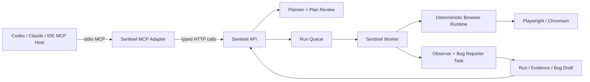

# Sentinel MCP Server

## Purpose

`apps/mcp` lets an MCP host use Sentinel's release-QA workflow while Sentinel keeps authority over browser execution, evidence, state, budgets, and approvals.



MCP is the client-facing protocol boundary. It is not Sentinel's browser runtime.

## Tools

| Tool | Effect | Approval/safety behavior |
| --- | --- | --- |
| `sentinel_create_run` | Creates a Run from Target URL and Test Goal | Does not launch a browser |
| `sentinel_generate_plan` | Creates a new DRAFT Plan | Never auto-approves |
| `sentinel_get_run` | Reads Run, Plan, Steps, Evidence metadata, and Bug summaries | Read-only |
| `sentinel_approve_plan` | Approves one exact Plan version | Stale versions fail |
| `sentinel_start_run` | Queues real browser QA | Requires exact approved version; marked destructive |
| `sentinel_get_bug` | Reads an evidence-bound Bug Draft | Read-only; no Issue creation |

The server intentionally has no public `click`, `fill`, selector, JavaScript, retry, filesystem, or GitHub write tool.

## Local use

Requirements:

- Node.js 20 or newer;
- the Sentinel API running at `SENTINEL_API_BASE_URL`;
- dependencies installed with `pnpm install`.

Development entrypoint:

```bash
pnpm dev:mcp
```

Production-style local entrypoint:

```bash
pnpm --filter @sentinel/mcp build
node apps/mcp/dist/stdio.js
```

An MCP host can launch the built server with a configuration equivalent to:

```json
{
  "servers": {
    "sentinel": {
      "type": "stdio",
      "command": "node",
      "args": ["C:/absolute/path/to/sentinel/apps/mcp/dist/stdio.js"],
      "env": {
        "SENTINEL_API_BASE_URL": "http://127.0.0.1:4000"
      }
    }
  }
}
```

The exact outer configuration key varies by host; the command, arguments, environment, and stdio transport are the portable parts.

## Expected host workflow

1. Call `sentinel_create_run`.
2. Call `sentinel_generate_plan`.
3. Call `sentinel_get_run` and present the DRAFT Plan to a human.
4. After explicit review, call `sentinel_approve_plan` with the exact version.
5. Call `sentinel_start_run` with the same version.
6. Call `sentinel_get_run` to inspect lifecycle and result.
7. On FAIL, call `sentinel_get_bug` for the evidence-bound draft.

Do not interpret `QUEUED`, `RUNNING`, transport success, or a successful MCP tool call as QA PASS.

## Current limitations

- Only local stdio transport is implemented; remote Streamable HTTP and OAuth are deferred.
- The API's current Run/outcome stores are process-local prototypes, not durable multi-tenant storage.
- `sentinel_start_run` only queues the Run and reports `executionFinished: false`. A Worker claims it from PostgreSQL; poll `sentinel_get_run` until `status` is `COMPLETED` or `FAILED`.
- Evidence is returned as redacted metadata and API view URLs; binary MCP resources are deferred.
- GitHub Issue approval/creation and regression re-test remain outside this phase.

## References

- [Official MCP TypeScript SDK server guide](https://github.com/modelcontextprotocol/typescript-sdk/blob/main/docs/server.md)
- [Official MCP stdio guide](https://github.com/modelcontextprotocol/typescript-sdk/blob/main/docs/get-started/first-server.md)
- [ADR-001: Direct Playwright vs Playwright MCP](adr/ADR-001-direct-playwright-vs-mcp.md)
- [ADR-002: Expose Sentinel as an MCP server](adr/ADR-002-sentinel-as-mcp-server.md)
