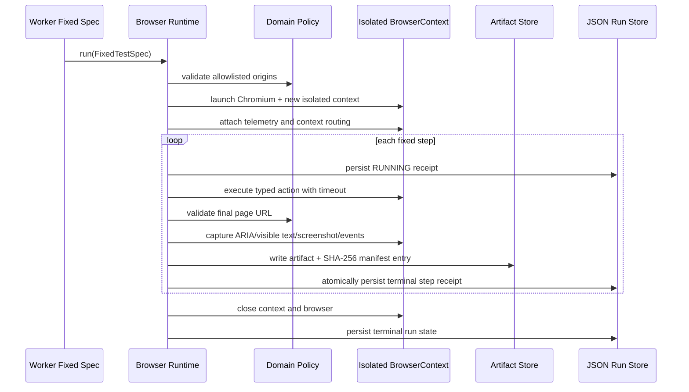

# Phase 2 — Deterministic Browser Runtime

## Scope

Phase 2 proves the browser execution layer without an LLM or Agent. A caller supplies a fixed, typed `FixedTestSpec`; the runtime executes only its allowlisted actions and returns persisted receipts and evidence.

Implemented actions:

- `navigate`
- `click` by accessible role/name, label, or exact text
- `fill` by accessible role/name, label, or exact text
- `snapshot`
- `screenshot`

Arbitrary CSS/XPath selectors, JavaScript evaluation, uploads, downloads, storage-state import, network mocking, and retries are not exposed.

## Runtime sequence



## Persistence and evidence

The Phase 2 development adapter uses atomic JSON replacement so the fixed runtime can be validated without a running PostgreSQL daemon:

```text
artifacts/runs/<run_id>/
├── run.json
├── steps/
├── observations/
├── console/
├── network/
├── screenshots/
└── manifest.json
```

`manifest.json` records relative key, MIME type, byte size, SHA-256, creation time, step ID, and redaction status. Binary artifacts are not embedded in run state.

PostgreSQL remains the planned canonical production store. The JSON adapter is a Phase 2 development/run-receipt adapter, not an architectural replacement for PostgreSQL.

## Isolation and safety

- One new Chromium `BrowserContext` per Run; it is always closed in `finally`.
- Downloads are disabled and service workers are blocked.
- Target origins include exact scheme, hostname, and port.
- Localhost requires explicit development mode.
- URL credentials are rejected.
- Navigation target, routable requests, and final page URL are checked.
- Fill actions marked `secret` persist `[REDACTED]`, not the input value.
- Exact secret values are preloaded into the redactor before the first navigation, so credentials rendered by the target are removed even from earlier observations.
- Automatic screenshots are replaced by an explicit `screenshot-suppressed` evidence record while a configured secret is visible; explicit unsafe screenshot actions fail as `EVIDENCE_FAILED`.
- Console/page-error text and observation text pass through centralized redaction.
- Network evidence stores metadata only; request/response bodies and headers are not captured.
- A timeout fails the current step and leaves remaining steps `SKIPPED`.
- Screenshot capture failure changes the error to `EVIDENCE_FAILED`; it cannot silently pass.
- A Run ID atomically owns a new artifact directory. Reusing an existing Run ID is rejected instead of mixing evidence generations.

Playwright documents that route handlers see only the first URL of a server redirect. Final URL validation therefore detects redirect escape and fails the Run, but an application-level allowlist is not a complete egress security boundary. A production Worker still requires container/host network policy and DNS/IP validation.

## Fixed TaskForge spec

`apps/worker/src/specs/taskforge.ts` runs:

1. Navigate to TaskForge in `none` Break Mode.
2. Fill demo email and password.
3. Log in.
4. Create `Sentinel Release`.
5. Rename it to `Sentinel Release Gate`.
6. Capture the final observation and screenshot.
7. Log out.

This is a deterministic execution proof. It does not decide expected-versus-actual or declare functional bugs; those remain gated behind later phases.
