# Phase 3 — Planner and Controlled QA Agent

## Outcome

Phase 3 adds a strict Planner, a human review gate, and a bounded QA execution loop. It does **not** add the Observer/Critic, bug detection, bug reports, or GitHub Issue creation. `EXECUTION_FINISHED` means the interaction sequence ended; it does not mean PASS.

## Control flow

```mermaid
flowchart LR
  Goal[Target URL + Test Goal] --> Planner[Planner Agent]
  Planner --> Schema[TestPlan schema + semantic validation]
  Schema --> Draft[DRAFT plan vN]
  Draft --> Review{Human review}
  Review -->|Edit| Draft
  Review -->|Regenerate| Planner
  Review -->|Approve exact version| Ready[READY]
  Ready --> Queue[Worker queue boundary]
  Queue --> Observe[Playwright observation]
  Observe --> QA[QA Agent decision]
  QA --> Policy[Schema, ref, origin, and budget validation]
  Policy --> Execute[Deterministic Playwright action]
  Execute --> Trace[Structured execution trace]
  Trace --> Observe
```



## Agent boundaries

### Planner Agent

- Input: target URL, natural-language goal, allowed origins, constraints, and maximum steps.
- Output: `TestPlan` schema version 1.
- Cannot browse, include selectors, include credentials, or claim a test result.
- Generated plans are always `DRAFT` and require explicit approval.

### QA Agent

- Input: the current approved step, current page observation, supplied element refs, recent structured decisions, and remaining budgets.
- Output: one `AgentDecision`: `ACTION`, `ASSERT`, `RETRY`, `PAUSE`, `ESCALATE`, `FINISH`, or `FAIL`.
- Cannot emit selectors. Click and fill actions must use a ref from the current observation.
- Page text is wrapped as untrusted content and cannot change the plan, policy, approval, or budgets.

### Deterministic workflow and tools

- The API versions drafts and rejects stale edits or approvals.
- The API does not launch a browser inside an HTTP request.
- The workflow enforces action, retry, and model-call budgets.
- `InteractiveBrowserSession` owns Chromium, domain policy, element-ref expiry, screenshot capture, timeouts, and secret resolution.
- The worker adapter is the only bridge from validated QA actions to Playwright.

## LLM providers and provenance

`GatewayLLMProvider` uses the AI SDK through Vercel AI Gateway with strict structured output. Each call records provider, model, prompt ID/hash, schema version, latency, token usage when returned, and a mock flag.

`MockLLMProvider` is deterministic and used in tests and explicit local demo mode. Its results always carry `isMock: true`, and the web UI displays `MOCK FIXTURE`. There is no silent fallback from a failed real provider to mock output.

Environment variables:

```text
SENTINEL_LLM_PROVIDER=gateway
SENTINEL_LLM_MODEL=deepseek/deepseek-v4-flash-0731
AI_GATEWAY_API_KEY=...
```

## Run and plan states

```text
CREATED -> PLANNING/DRAFT -> READY/APPROVED -> QUEUED
```

- Generate and regenerate increment the plan version.
- Human edits increment the version and record `human-edit` provenance.
- Approval requires the exact visible version.
- Start requires the exact approved plan and returns `202 QUEUED`.

The current API repository is process-local and intended for Phase 3 review. Durable PostgreSQL plan/run persistence and a queue consumer remain required before production use.

## Verification coverage

- TestPlan and AgentDecision schema and semantic rejection.
- Planner and QA Agent mock provenance.
- Plan creation, regeneration, edit, stale approval rejection, and approval gate.
- Web generation, visible mock labelling, edit, regenerate, and approval.
- Real Chromium observation, grounded refs, stale-ref rejection, and action execution.
- Combined worker integration: mock QA decisions drive real Playwright navigation and click.

## Known limitations and next review gate

- No Observer/Critic; no PASS, FAIL, or UNCERTAIN judgment.
- No bug classification or report generation.
- API plan state is not yet durable and the queue response is not yet backed by a production queue.
- No live model result is claimed unless the Gateway credentials are configured and the call succeeds.
- The interactive path captures explicit screenshots but does not yet persist the full Phase 2 telemetry bundle for every adaptive action.

Stop here for human review before Phase 4.
