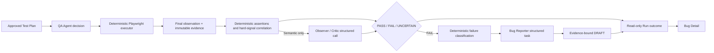

# Phase 4 — Observer and Evidence-bound Bug Detection

## Outcome

Phase 4 adds evidence-bound `PASS | FAIL | UNCERTAIN` judgments, deterministic failure classification, structured Bug Report Drafts, a read-only outcome API, and Bug Detail UI. A browser action completing successfully is never treated as proof that the product passed.

This phase does **not** create GitHub Issues, approve Bug Reports, generate regression specifications, re-test fixes, or perform any other external write.

## Evaluation flow



## Agent, workflow, and tool boundaries

### Observer / Critic

- Compares the approved `expectedState` with one frozen final observation.
- Runs deterministic typed assertions first.
- Cannot override a correlated hard failure.
- Calls the LLM only for semantic comparisons that deterministic rules cannot resolve.
- Low-confidence decisive output is downgraded to `UNCERTAIN`.
- An invalid observation, unhealthy capture, foreign evidence, or missing evidence becomes `UNCERTAIN`, never PASS.

### Bug Reporter

- Is a one-shot structured transformation task, not a fourth autonomous Agent.
- Runs only for a failed assertion.
- Must preserve the assertion's Expected and Actual values exactly.
- Can cite only Evidence owned by that Run and Step.
- Must use deterministic reproduction steps derived from stored browser action receipts.
- Produces an internal `DRAFT`; it has no authority to create or approve an Issue.

### Deterministic workflow and tools

- Playwright alone performs low-level browser interactions.
- The workflow owns budgets, final capture, verdict aggregation, failure-signal precedence, and safe error handling.
- Browser errors remain execution failures and do not automatically become product Bugs.
- `OutcomeStore` validates and defensively copies complete outcome snapshots.
- HTTP endpoints are read-only views over the store. Artifact keys remain internal; browser clients receive controlled evidence URLs.

## Contracts

The strict version 1 contracts live in `packages/contracts`:

- `DeterministicAssertion`
- `Evidence`
- `AssertionResult`
- `BugReport`

Decisive assertions require at least one valid Evidence ID. `UNCERTAIN` may intentionally carry no Evidence when capture itself failed. Screenshot and trace evidence require a persisted artifact and SHA-256 hash.

Run lifecycle and QA result are separate:

```text
status: COMPLETED + result: FAIL       => product acceptance failure
status: COMPLETED + result: UNCERTAIN  => human review required
status: FAILED                         => execution/infrastructure failure
```

## Evidence capture

`InteractiveBrowserSession` binds every capture to immutable `runId + stepId` ownership and records:

- redacted ARIA/DOM-derived state;
- redacted visible text;
- screenshots when the safety policy permits them;
- console errors;
- target-origin HTTP failures and request failures;
- page and Playwright errors;
- artifact path, SHA-256, timestamp, and redaction status.

Element refs remain scoped to the latest observation. Event cursors prevent console or network evidence from being reused across steps. Secret references are resolved inside the browser session and exact values are redacted before persistence or model input.

## Read-only API

- `GET /api/v1/runs/:runId`
- `GET /api/v1/runs/:runId/steps`
- `GET /api/v1/runs/:runId/evidence`
- `GET /api/v1/runs/:runId/bugs`
- `GET /api/v1/bugs/:bugId`
- `GET /api/v1/evidence/:evidenceId/artifact`

The Bug Detail response preserves DRAFT status, model provenance, Expected, Actual, ordered reproduction steps, and Evidence order. No Phase 5 mutation route is registered.

## Verification coverage

- Evidence, AssertionResult, BugReport, and typed assertion contract validation.
- Deterministic PASS/FAIL, semantic UNCERTAIN, hard-failure precedence, and malformed observation handling.
- Browser action-error Evidence retention without product Bug creation.
- Real Chromium evidence capture, artifact hashes, redaction, event step ownership, and stale-ref handling.
- Outcome aggregation, cross-run/step evidence rejection, defensive reads, and globally unambiguous Bug Detail.
- Read-only API behavior for NOT_EVALUATED, PASS, FAIL, and UNCERTAIN.
- Bug Detail Expected/Actual separation, reproduction order, screenshot rendering, mock provenance, and absence of Phase 5 controls.

## Known limitations and next review gate

- Superseded: Run and Outcome state now lives in PostgreSQL and a Worker consumes the queue. See [End-to-end demo](e2e-demo.md).
- The adaptive runtime currently supports one primary page; popup and multi-page Evidence ownership is deferred.
- Failure correlation is intentionally conservative and will require a configurable request-noise policy for broader applications.
- Mock fixtures are visibly labelled. No live model result is claimed without configured provider credentials and a successful call.
- GitHub Issue Draft approval, Issue creation, tool-ledger idempotency, RegressionSpec, and re-test belong to Phase 5.

Stop here for human review before Phase 5.
